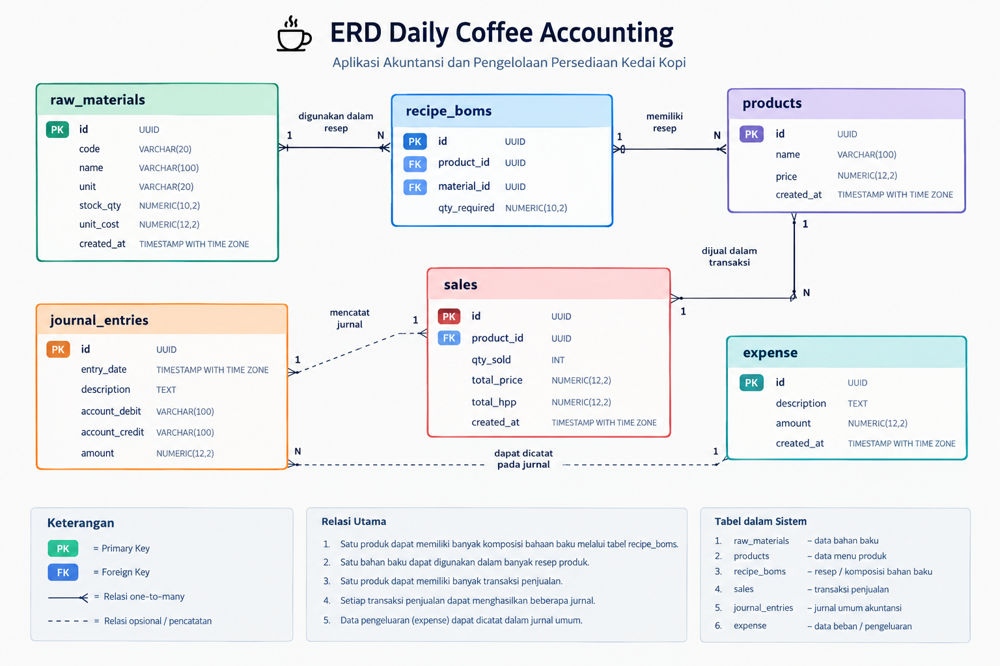

# ☕ Daily Coffee Accounting

**Aplikasi Akuntansi dan Pengelolaan Persediaan Daily Coffee**

## 1. Deskripsi Proyek

Daily Coffee Accounting merupakan aplikasi berbasis web yang dirancang untuk membantu proses pencatatan transaksi dan pengelolaan persediaan bahan baku pada usaha kedai kopi. Aplikasi ini menggunakan Supabase sebagai database untuk menyimpan data bahan baku, menu produk, transaksi penjualan, serta jurnal umum akuntansi.

Aplikasi ini dikembangkan untuk membantu proses pencatatan akuntansi menjadi lebih terstruktur, mempermudah pemantauan stok bahan baku, serta menyajikan informasi penjualan dan laba kotor.

**Link aplikasi:** https://imaninashdrina.github.io/daily-coffee-accounting/

**Link repository GitHub:** https://github.com/imaninashdrina/daily-coffee-accounting

## 2. Identitas Pengembang

| Keterangan | Informasi |
|---|---|
| Nama Mahasiswa | Imanina Nur Shadrina |
| NIM | 12030124140230 |
| Kelas | D |
| Mata Kuliah | Pengkodean dan Pemograman |
| Dosen Pengampu | Dr. Totok Dewayanto, S.E., M.Si., Akt. |

## 3. Fitur Aplikasi

### A. Dashboard

- Menampilkan informasi persediaan bahan baku.
- Menghitung nilai aset persediaan.
- Menampilkan total penjualan dan laba kotor.
- Memberikan informasi bahan baku dengan stok rendah.
- Menampilkan transaksi penjualan terbaru.

### B. Pembelian Bahan Baku

- Mengambil data bahan baku dari database.
- Mencatat penambahan persediaan bahan baku.
- Memperbarui jumlah stok dan biaya per unit menggunakan metode rata-rata bergerak (*moving average*).
- Mencatat jurnal pembelian persediaan bahan baku.

### C. Penjualan Produk

- Mengambil data menu produk dan resep bahan baku.
- Memeriksa ketersediaan bahan baku sebelum penjualan diproses.
- Mengurangi stok berdasarkan kebutuhan bahan baku dalam resep.
- Menghitung total penjualan dan Harga Pokok Penjualan (HPP).
- Mencatat jurnal penjualan dan jurnal HPP.

### D. Persediaan

- Menampilkan data bahan baku.
- Menyajikan informasi jumlah stok, satuan, dan biaya per unit.
- Membantu memantau ketersediaan bahan baku.

### E. Jurnal Umum

- Menyimpan tanggal transaksi dan deskripsi transaksi.
- Mencatat akun debit dan akun kredit.
- Menyimpan nominal transaksi untuk dokumentasi akuntansi.

## 4. Teknologi yang Digunakan

- **HTML5** — membangun struktur halaman web.
- **CSS3** — mengatur tampilan dan tata letak aplikasi.
- **JavaScript** — menjalankan logika aplikasi dan pengolahan transaksi.
- **Supabase** — menyediakan database PostgreSQL dan akses data melalui Supabase JavaScript Client.
- **Font Awesome** — menyediakan ikon antarmuka.
- **GitHub** — menyimpan source code proyek.
- **GitHub Pages** — mempublikasikan aplikasi web.

## 5. Struktur Repository

```text
daily-coffee-accounting/
├── app.js
├── index.html
├── jurnal.html
├── pembelian.html
├── penjualan.html
├── persediaan.html
├── style.css
├── logo.jpeg
└── README.md
```

Keterangan:

- `index.html`: halaman dashboard aplikasi.
- `jurnal.html`: halaman jurnal umum.
- `pembelian.html`: halaman pembelian bahan baku.
- `penjualan.html`: halaman transaksi penjualan.
- `persediaan.html`: halaman persediaan bahan baku.
- `app.js`: logika aplikasi dan integrasi database Supabase.
- `style.css`: pengaturan tampilan aplikasi.
- `logo.jpeg`: gambar logo Daily Coffee.
- `README.md`: dokumentasi proyek.

## 6. Database Supabase

Aplikasi menggunakan Supabase sebagai database untuk menyimpan dan mengambil data transaksi serta persediaan.

### A. Tabel `raw_materials`

Digunakan untuk menyimpan informasi bahan baku.

| Kolom | Tipe Data | Keterangan |
|---|---|---|
| `id` | UUID | Primary key bahan baku |
| `code` | VARCHAR(20) | Kode bahan baku |
| `name` | VARCHAR(100) | Nama bahan baku |
| `unit` | VARCHAR(20) | Satuan bahan baku |
| `stock_qty` | NUMERIC(10,2) | Jumlah persediaan |
| `unit_cost` | NUMERIC(12,2) | Biaya per satuan |
| `created_at` | TIMESTAMPTZ | Waktu pembuatan data |

### B. Tabel `products`

Digunakan untuk menyimpan informasi menu produk.

| Kolom | Tipe Data | Keterangan |
|---|---|---|
| `id` | UUID | Primary key produk |
| `name` | VARCHAR(100) | Nama produk |
| `price` | NUMERIC(12,2) | Harga jual |
| `created_at` | TIMESTAMPTZ | Waktu pembuatan data |

### C. Tabel `recipe_boms`

Digunakan untuk menyimpan resep atau komposisi bahan baku yang diperlukan untuk membuat produk.

| Kolom | Tipe Data | Keterangan |
|---|---|---|
| `id` | UUID | Primary key resep |
| `product_id` | UUID | Foreign key ke tabel `products` |
| `material_id` | UUID | Foreign key ke tabel `raw_materials` |
| `qty_required` | NUMERIC(10,2) | Jumlah bahan baku yang dibutuhkan |

### D. Tabel `sales`

Digunakan untuk menyimpan transaksi penjualan.

| Kolom | Tipe Data | Keterangan |
|---|---|---|
| `id` | UUID | Primary key transaksi |
| `product_id` | UUID | Foreign key ke tabel `products` |
| `qty_sold` | INT | Jumlah produk terjual |
| `total_price` | NUMERIC(12,2) | Total harga penjualan |
| `total_hpp` | NUMERIC(12,2) | Total harga pokok penjualan |
| `created_at` | TIMESTAMPTZ | Waktu transaksi |

### E. Tabel `journal_entries`

Digunakan untuk menyimpan jurnal umum akuntansi.

| Kolom | Tipe Data | Keterangan |
|---|---|---|
| `id` | UUID | Primary key jurnal |
| `entry_date` | TIMESTAMPTZ | Tanggal pencatatan |
| `description` | TEXT | Keterangan transaksi |
| `account_debit` | VARCHAR(100) | Akun debit |
| `account_credit` | VARCHAR(100) | Akun kredit |
| `amount` | NUMERIC(12,2) | Nominal transaksi |

Tabel ini belum memiliki foreign key yang menghubungkannya secara langsung dengan tabel transaksi. Jurnal menyimpan informasi pencatatan berdasarkan tanggal, deskripsi, akun debit, akun kredit, dan nominal transaksi.

### F. Tabel `public.expense`

Tabel ini tersedia pada Supabase untuk menyimpan data beban atau pengeluaran. Berdasarkan informasi yang tersedia, tabel tersebut masih kosong karena belum ada data pengeluaran yang tersimpan.

Penggunaan tabel ini dalam fitur laporan perlu disesuaikan dengan nama tabel dan kolom yang dipanggil oleh kode aplikasi.

## 7. Entity Relationship Diagram (ERD)

Entity Relationship Diagram (ERD) merupakan diagram yang menggambarkan struktur tabel serta hubungan antarentitas dalam database Daily Coffee Accounting.

### A. Struktur Relasi Database

Relasi utama yang didefinisikan dalam SQL adalah sebagai berikut:

1. **`products` ke `recipe_boms`**: satu produk dapat memiliki beberapa komposisi resep. Kolom `recipe_boms.product_id` mengacu pada `products.id`.
2. **`raw_materials` ke `recipe_boms`**: satu bahan baku dapat digunakan dalam beberapa resep. Kolom `recipe_boms.material_id` mengacu pada `raw_materials.id`.
3. **`products` ke `sales`**: satu produk dapat muncul dalam beberapa transaksi penjualan. Kolom `sales.product_id` mengacu pada `products.id`.
4. **`journal_entries`**: menyimpan catatan jurnal umum, tetapi belum memiliki foreign key langsung ke tabel penjualan atau pembelian.
5. **`expense`**: tersedia sebagai tabel pengeluaran, tetapi belum memiliki data yang tersimpan.

### B. Diagram ERD



### C. Keterangan ERD

- **PK (Primary Key)** merupakan kolom identitas unik pada suatu tabel.
- **FK (Foreign Key)** merupakan kolom yang menghubungkan suatu tabel dengan tabel lain.
- Relasi resep digunakan untuk menghubungkan menu produk dengan bahan baku yang dibutuhkan.
- Relasi penjualan digunakan untuk menghubungkan transaksi dengan produk yang terjual.
- Jurnal umum menyimpan pencatatan akuntansi tanpa relasi foreign key langsung ke transaksi.
- Tabel pengeluaran tersedia, tetapi masih kosong.

**Catatan:** diagram ERD harus mencerminkan relasi yang benar-benar diterapkan pada database Supabase. Garis yang hanya menggambarkan alur pencatatan tidak boleh dianggap sebagai foreign key apabila tidak didefinisikan dalam SQL.

## 8. Alur dan Logika Akuntansi

### A. Pembelian Bahan Baku

Pembelian menambah jumlah stok bahan baku. Sistem menghitung biaya rata-rata baru berdasarkan nilai persediaan sebelumnya dan biaya pembelian.

**Rumus biaya rata-rata:**

Biaya rata-rata baru = (Nilai persediaan lama + Nilai pembelian) / (Jumlah stok lama + Jumlah stok yang dibeli)

Pencatatan jurnal pembelian:

| Akun Debit | Akun Kredit |
|---|---|
| Persediaan Bahan Baku | Kas |

### B. Penjualan Produk

Ketika penjualan dilakukan, sistem mengambil resep produk untuk menghitung kebutuhan bahan baku dan memeriksa ketersediaan stok. Jika stok mencukupi, sistem mengurangi stok sesuai resep dan mencatat transaksi penjualan.

### C. Perhitungan Penjualan dan HPP

Total penjualan dihitung berdasarkan harga jual produk dikalikan jumlah produk yang terjual.

HPP dihitung berdasarkan biaya bahan baku yang digunakan dalam resep produk dikalikan jumlah produk yang terjual, sesuai perhitungan dalam aplikasi.

**Rumus laba kotor:**

Laba Kotor = Total Penjualan − Total HPP

### D. Pencatatan Jurnal Penjualan

| Akun Debit | Akun Kredit |
|---|---|
| Kas | Pendapatan Penjualan |

### E. Pencatatan Jurnal HPP

| Akun Debit | Akun Kredit |
|---|---|
| Beban HPP | Persediaan Bahan Baku |

## 9. Data Awal Bahan Baku dan Produk

Database awal menyediakan contoh data berikut.

### A. Bahan Baku

| Kode | Nama Bahan Baku | Satuan | Stok Awal | Biaya per Satuan |
|---|---|---|---:|---:|
| MAT-01 | Biji Kopi Arabika | gram | 2.000 | Rp250 |
| MAT-02 | Susu UHT Fresh | ml | 5.000 | Rp20 |
| MAT-03 | Paper Cup 16oz | pcs | 200 | Rp1.500 |

### B. Menu Produk

| Nama Produk | Harga Jual |
|---|---:|
| Caffe Latte 16oz | Rp28.000 |
| Espresso Single | Rp18.000 |

Resep awal yang tersedia dalam SQL mencakup Caffe Latte 16oz, dengan kebutuhan:

- 18 gram biji kopi Arabika.
- 200 ml susu UHT Fresh.
- 1 buah Paper Cup 16oz.

Resep Espresso Single perlu ditambahkan jika menu tersebut akan diproses melalui fitur penjualan berbasis resep.

## 10. Cara Menjalankan Aplikasi

1. Buka repository GitHub Daily Coffee Accounting.
2. Unduh atau salin seluruh source code.
3. Pastikan project Supabase sudah dibuat dan tabel yang diperlukan tersedia.
4. Pastikan konfigurasi koneksi Supabase pada `app.js` sesuai dengan project database yang digunakan.
5. Jalankan `index.html` melalui browser atau server lokal.
6. Buka halaman dashboard untuk melihat informasi persediaan dan penjualan.
7. Gunakan halaman pembelian, penjualan, persediaan, dan jurnal sesuai fungsi masing-masing.

Aplikasi yang telah dipublikasikan juga dapat diakses melalui GitHub Pages:

https://imaninashdrina.github.io/daily-coffee-accounting/

## 11. Pengujian Aplikasi

Pengujian dapat dilakukan melalui beberapa skenario berikut:

1. Memastikan dashboard dapat menampilkan data persediaan dan penjualan.
2. Memastikan pembelian menambah stok bahan baku dan memperbarui biaya rata-rata.
3. Memastikan penjualan berhasil jika stok bahan baku mencukupi.
4. Memastikan penjualan ditolak jika stok bahan baku tidak mencukupi.
5. Memastikan stok bahan baku berkurang berdasarkan resep produk.
6. Memastikan transaksi menghasilkan jurnal penjualan dan jurnal HPP.
7. Memastikan halaman jurnal menampilkan pencatatan yang tersimpan di database.

Hasil pengujian harus disesuaikan dengan hasil aktual ketika setiap skenario dijalankan.

## 12. Catatan Pengembangan

- Struktur tabel dan nama kolom pada dokumentasi mengikuti SQL database yang tersedia.
- Tabel `public.expense` masih kosong sehingga belum terdapat data pengeluaran yang dapat ditampilkan dari tabel tersebut.
- Nama tabel beban pada kode aplikasi dan Supabase perlu dipastikan konsisten.
- Operasi pembelian dan penjualan yang melibatkan beberapa perubahan database perlu dilindungi dengan transaksi database atau fungsi server agar konsistensi stok dan jurnal tetap terjaga jika terjadi kegagalan.
- Akses database perlu dilindungi menggunakan kebijakan keamanan Supabase yang sesuai.
- Dokumentasi ini menjelaskan fitur dan logika yang terdapat dalam proyek, bukan menyatakan bahwa aplikasi telah memenuhi seluruh standar akuntansi atau audit.

## 13. Kesimpulan

Daily Coffee Accounting merupakan aplikasi berbasis web untuk membantu pengelolaan persediaan bahan baku, transaksi penjualan, perhitungan HPP, dan pencatatan jurnal umum pada usaha kedai kopi.

Integrasi dengan Supabase memungkinkan data aplikasi disimpan dan diakses melalui database terpusat. Proyek ini menjadi penerapan teknologi web dalam mendukung proses administrasi dan pencatatan akuntansi usaha secara lebih terstruktur.
